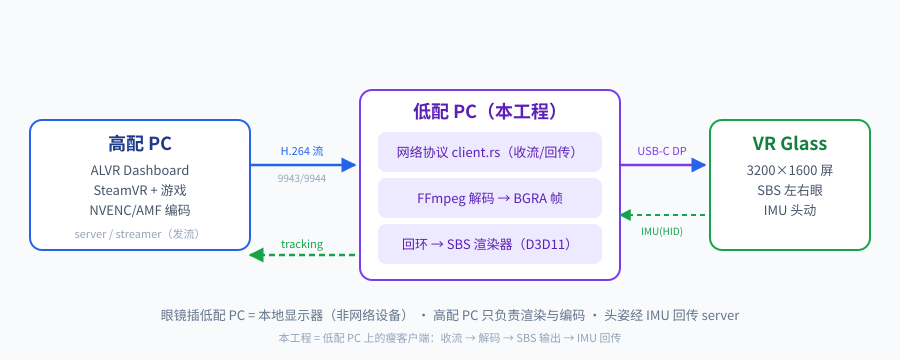

# Huawei VR Glass 串流接收端（低配 PC 版）

把华为 VR Glass 插在**低配 PC** 上，让这台 PC 接收**高配 PC** 的 ALVR 串流，以 SBS 左右眼立体输出到眼镜，并用 IMU 回传头姿。

> **本轮新增**：① 已交叉编译出 Windows x86-64 exe（`hvr-alvr-win-sink.exe`，PE32+，wine 实测可运行）；
> ② 设备状态显示——头显/手机是否插上、电池，见 [`docs/05-设备状态显示.md`](docs/05-设备状态显示.md)。
> 直接跑 `hvr-alvr-win-sink.exe --status` 查看状态。

> 这不是把手机 APK 移植到 Windows。眼镜插在 PC 上时是一块 **3200×1600 本地显示器**，不是网络设备。
> 本工程是一个"瘦客户端"：收 ALVR 流 → 解码 → SBS 画到本地屏 → IMU 回传头姿。



## 状态

| 项 | 状态 |
|---|---|
| ALVR v20.14.1 线协议（发现/握手/控制/流/tracking） | ✅ 已对齐服务端分片/粘包/能力集，`cargo test` 24/24 通过 |
| H.264 Annex B → BGRA 解码（FFmpeg 管道） | ✅ 实现并通过参数/尺寸单测 |
| 本地回环帧输出 + IMU 姿态输入 | ✅ 实现并通过 UDP 回环集成测试 |
| 头显/手机状态 + 电池显示 + Battery 回传 | ✅ 实现，`--status` 可用，4 项单测通过 |
| **Windows 交叉编译 exe** | ✅ 已产出 PE32+，`file` 验证 + wine 实跑 `--selftest`/`--status` 通过 |
| 真机点亮 / 与 server 互通 | ⚠️ 需在你自己的 Windows + 眼镜上按文档验证 |
| 手柄输入 | ❌ 未实现（3DoF 头动可用） |

## 目录

```
hvr-alvr-win-sink/
├── Cargo.toml                 # 独立 crate，零上游依赖
├── sink_config.json           # 配置模板
├── src/
│   ├── main.rs                # 入口：串起来 网络→解码→渲染
│   ├── protocol.rs            # ALVR 线协议结构与编解码（含单测）
│   ├── client.rs              # 发现/握手/收流重组/tracking 回传主循环
│   ├── decoder.rs             # FFmpeg 管道解码（含单测）
│   ├── render_bridge.rs       # TCP 帧输出 + UDP IMU 输入（含集成测试）
│   └── status.rs              # ★ 头显/手机状态 + 电池采集（含单测）
├── hvr-alvr-win-sink.exe      # ★ 交叉编译产物（Windows x86-64, PE32+）
├── cpp/                       # （保留）渲染器补丁说明见 docs/04
├── scripts/
│   └── send_test_frame.py     # 给渲染器发测试帧，验证 SBS 通道
├── docs/
│   ├── 01-架构与可行性.md     # ★ 先读：物理约束 + 为什么这么设计 + 协议规格
│   ├── 02-构建与运行.md       # 编译、配置、运行顺序、排错
│   ├── 03-接线与调优.md       # 两端协同、延迟、坐标系、手柄接入
│   ├── 04-渲染器补丁.md       # ★ 让 HwVRDesktop 从网络收帧的精确改动
│   └── 05-设备状态显示.md     # ★ 头显/手机状态与电池
└── verify.sh                  # 交付自检
```

## 2026-11-25 协议与几何修复

- 分片长度字段改为服务端语义 `4 + payload_len`（旧代码多算 14 字节，第一片就错位）。
- 控制通道 `ctl_buf` 跨调用保留，`StreamConfig`/`DecoderConfig`/`StartStream` 粘包不再丢包。
- 重组器按 `stream_id` 分桶，音频/统计分片不再冲掉视频重组。
- 流通道按 `stream_protocol`/`wired`/session 选择 TCP 或 UDP，并使用 session 的 `stream_port`。
- 能力集发送完整 JSON，显式关闭 AV1/10-bit/foveated；`codec` 改为上游 `CodecType` 枚举。
- FOV 用服务端语义的半角**弧度** `±0.829`（47.5°，tan=1.0913），修正旧配置四个正值导致投影边界反向；IPD 63 mm；渲染器 ini 的 `fov_tan` 仍为 1.0913。
- Windows core 已按新源码重新交叉编译，`产物/客户端-PC/hvr-alvr-win-sink.exe` 为 1.5 MB 新版。

## 快速开始

```powershell
# 1) 自检（无需硬件/网络）
cargo test
.\target\release\hvr-alvr-win-sink.exe --selftest

# 2) 构建 SBS 渲染器：先按 docs/04 打补丁，再
pwsh -NoProfile -File <上游仓库>\scripts\huawei\build-desktop-mode.ps1

# 3) 运行：先渲染器，后接收端
HwVRDesktop.exe
hvr-alvr-win-sink.exe
```
详细步骤见 [`docs/02-构建与运行.md`](docs/02-构建与运行.md)。

## 关键限制（务必读）

1. **3DoF**：只读 IMU 朝向，无位置追踪（华为 SLAM 私有不可逆向）。
2. **手柄未实现**：聚焦"画面能看、头动能跟"。
3. **渲染器需使用网络收帧版**：上游 HwVRDesktop 默认采集桌面；本包 `renderer/HwVRDesktop.exe` 已是 patch 版，ini 需保持 `[s3d] mode=1`、`ipd=63`、`fov_tan=1.0913`。
4. **无法在本环境真机验证**：Rust 侧已充分自测；Windows 渲染/眼镜点亮需你验证。

## 来源与依据

- 协议：`HuaweiVRGlass-ALVR-main/alvr/{packets,sockets,client_core}/src/`
- 渲染：`deps/huawei-desktop/`（MIT, (c) fkun1754）
- 物理事实与踩坑：仓库 `.workbuddy/memory/` 开发日志（2026-10 ~ 11）
- 逐条证据索引见 `docs/01-架构与可行性.md` 第 7 节
